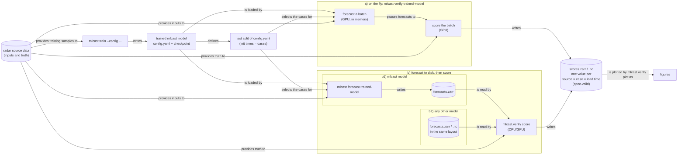

# mlcast-verification-tools

Verification scores and plots for precipitation nowcasts, reproducing the verification
figures of the IRENE paper ([arXiv:2609.17175](https://arxiv.org/html/2609.17175v1)),
with the MLCast `verification/forecast_scoring_metrics` format (spec v0.1.0,
[mlcast-dataset-validator](https://github.com/leifdenby/mlcast-dataset-validator)) as
the intermediate file between scoring and plotting.

Scores can be computed in two ways, the second with two sources of forecasts:



- **a) On the fly** never stores the forecasts: each batch of cases is forecast and
  scored on the GPU and then discarded. It is the cheapest path for an mlcast model, and
  the only one that can also score the persistence baseline in the same pass and score
  test crops (`--crops`).
- **b) Forecast to disk, then score** keeps the forecasts, so they can be inspected and
  re-scored. The truth is any radar dataset on the same grid, e.g. an mlcast source
  dataset that passes
  [mlcast-dataset-validator](https://github.com/leifdenby/mlcast-dataset-validator).
  - **b1)** forecasts of a trained mlcast model, written by
    `mlcast forecast-trained-model`.
  - **b2)** forecasts of any other model, as long as they have the layout described
    under [Usage](#usage) (`ds_forecasts`). The validator has no spec for forecast
    datasets yet, so the forecast layout is defined by this package for now.

For an mlcast model, a) and b1) give the same scores for the same cases, ensemble size
and seed.

## What is a "case"?

A **forecast case** is one initialisation time (`init_time`): the forecast started from
the radar observations up to that time, over a fixed verification domain. Every forecast
source is run for the same cases, so cases are what the sources are compared over.

Each stored score value belongs to one **forecast source × case × lead time**. To get it,
the forecast (all ensemble members) for that lead time is compared with the radar
observation at the valid time `init_time + lead_time`. The comparison is reduced over all
valid pixels of the domain (and over members, as the metric requires) to a single number,
or to a small vector for the rank histogram (over `rank`) and the spectra (over
`wavelength`).

Scores are **not** averaged over cases in the file. Averaging over cases (over
`init_time`) happens at plot time. Keeping the per-case values is what the spec asks for:
it lets the scores be bootstrapped over cases (e.g. by mlwp-scorecard), and it allows
subsets of cases (a season, rainy days) to be selected later.

## Metrics

Every metric is computed per case and lead time, then stored. Averaging over cases and
the quantities derived from those averages are computed at plot time.

Scores are computed in the **native units of the verified variable**, without unit
conversion (see [Units](#units)). The table shows a rain rate `tp` in mm h-1, as in the
paper; for e.g. a radar reflectivity `dbz` in dBZ the scores are `mae.dbz` in dBZ,
`psd.dbz` in dBZ2 km, and so on.

| Metric | Paper | Stored as | Extra dim | Units | Polarity | Plot-time derivation |
|---|---|---|---|---|---|---|
| MAE of the ensemble mean | Eq. 21, Fig. 4 | `mae.tp` | – | mm h-1 | known | mean over cases |
| CRPS (ensemble estimator) | Eqs. 8, 22, Fig. 5 | `crps.tp` | – | mm h-1 | known | mean over cases |
| Rank histogram (rel. frequency; values < 0.037 mm/h count as zero, random tie-breaking) | Eq. 23, Fig. 6 | `rank_histogram.tp` | `rank` | 1 | `neutral` (declared) | mean over cases (and lead times for "full forecast") |
| Rank-histogram RMSD from uniform | Eq. 24, Fig. 6 | — | | | | from the case-averaged histogram |
| Radial PSD, forecast (mean over members) | Eqs. 16–17, Fig. 7 | `psd.tp` | `wavelength` (km) | mm2 h-2 km | `activity` (declared) | mean over cases |
| Radial PSD, observation | Eqs. 16–17, Fig. 7 | `psd_obs.tp` | `wavelength` (km) | mm2 h-2 km | `activity` (declared) | mean over cases |
| Excess power | Fig. 7 | — | | dB | | 10·log10(mean psd / mean psd_obs) at ≈74, 16, 4 km |

MAE = Mean Absolute Error, CRPS = Continuous Ranked Probability Score, RMSD = Root Mean
Square Deviation, PSD = Power Spectral Density (radially averaged, a.k.a. RAPSD).

The paper's case-study maps (Fig. 3) show raw fields rather than scores, so they are not
part of the score file.

## Install

PyTorch is installed through one of the `cpu`, `gpu-cu126`, `gpu-cu128` or
`gpu-cu130` extras, as in mlcast:

```bash
uv sync                                    # reading, writing and plotting score files
uv sync --extra cpu                        # + torch score kernels on CPU (offline scoring)
uv sync --extra gpu-cu128 --extra mlcast   # + on-the-fly GPU scoring of mlcast models
```

## Development

```bash
uv sync --extra cpu --extra mlcast   # dev tools (pytest, pre-commit, ruff, validator) included
uv run pre-commit install            # run ruff, pyproject-fmt etc. on every commit
uv run pytest
```

CI runs the tests and the pre-commit hooks on every push and pull request. Pull
requests must add an entry to `CHANGELOG.md` (or carry the `no changelog` label).
Publishing a GitHub release uploads the package to PyPI via trusted publishing; the
version comes from the git tag.

## Usage

Verification has three steps: **forecasts** (`ds_forecasts`) and **truth** (`ds_truth`)
go into **`compute_scores`**, which gives the per-case scores. A trained mlcast model is
described by its **training config** (the `config.yaml` mlcast writes next to
`checkpoints/`) and a **checkpoint**. The config defines the network, the source data,
the variable, the input/forecast steps and the test split.

```python
from mlcast_verification_tools.integrations.mlcast import (
    forecast_mlcast, load_run_config, open_truth, verify_mlcast_run,
)
from mlcast_verification_tools.offline import compute_scores
from mlcast_verification_tools.io import write_scores, validate_scores
from mlcast_verification_tools.plots import plot_all

config = load_run_config("logs/mlcast/version_3/config.yaml")  # the run's training config
checkpoint = "logs/mlcast/version_3/checkpoints/best.ckpt"

# a) forecast and score on the fly on the GPU, never storing the forecasts
scores = verify_mlcast_run(config, checkpoint, ensemble_size=20)

# b1) or forecast to disk first (written to Zarr batch by batch), then score
ds_forecasts = forecast_mlcast(config, checkpoint, ensemble_size=20, out="forecasts.zarr")
ds_truth = open_truth(config)                     # the run's radar data, in its own units
scores = compute_scores(ds_forecasts, ds_truth)  # on the GPU if available

path = write_scores(scores, "scores.zarr", title="...", forecasts="...", truth="...")
validate_scores(path).console_print()
plot_all(scores, "figures/")
```

a) and b1) give the same scores for the same arguments and seed. Forecasts of other
models are scored like b1) (path b2), by building `ds_forecasts` yourself:

- `ds_forecasts`: a data variable (default `tp`, choose with `variable=`) with dims
  `(forecast_source, init_time, lead_time, member, y, x)` and a `units` attribute.
  Sources with fewer members are NaN-padded along `member`; the `forecast_source` dim
  may instead be a scalar coordinate.
- `ds_truth`: the same data variable with dims `(time, y, x)` on the same grid, in the
  same units; NaN marks invalid pixels.

The scores are named after the variable (`mae.tp`, `mae.dbz`, ...) and are in its units.

Scores of different sources are combined with
`mlcast_verification_tools.accumulator.merge_sources`.

The same steps on the command line. `--config` is always required. Run from the
directory training was started from, because the config's data paths (e.g.
`./data/radar.zarr`) are relative; otherwise pass `--data-root`, or
`--zarr-path`/`--index-path`:

```bash
RUN=logs/mlcast/version_3

# a) on the fly
mlcast verify-trained-model --config $RUN/config.yaml --checkpoint $RUN/checkpoints/best.ckpt \
    --out scores.zarr

# b1) or forecast to disk, then score
mlcast forecast-trained-model --config $RUN/config.yaml --checkpoint $RUN/checkpoints/best.ckpt \
    --out forecasts.zarr
mlcast.verify score forecasts.zarr --truth-from-config $RUN/config.yaml --out scores.zarr

# b2) forecasts of another model, against a truth dataset on the same grid
mlcast.verify score other_forecasts.zarr --truth radar.zarr --out scores_other.zarr

mlcast.verify plot scores.zarr --out figures/
```

`mlcast forecast-trained-model` and `mlcast verify-trained-model` are registered as
`mlcast` subcommands through mlcast's CLI plugin hook (entry-point group
`mlcast.commands`). With an mlcast version that doesn't have the hook yet, use
`mlcast.verify forecast-trained-model` / `mlcast.verify verify-trained-model`, which
take the same arguments.

The **cases are the unique init times of the crops mlcast's sampler selects for the test
split** (`--split val` for the validation split). mlcast samples crops (256×256 pixels by default) from
`time_depth`-step windows of a sampling index, using the config's `eval_selector` with a
fixed seed, so the selection is reproducible. Each selected window start `t` gives the
init time of frame `t + input_steps - 1`: the inputs are the first `input_steps` frames of
the window. Several crops at the same time give one case. Each case is then forecast over
the **full radar domain** (or a fixed `--region-y/--region-x`), because a score file
holds one value per source, init time and lead time.

`verify-trained-model` also scores the **persistence baseline** by default, as forecast
source `persistence`: the last observed input frame (in the source units, prepared like
the truth) at every lead time, scored in the same pass on the same cases, pixels and
crops as the model, at almost no extra cost. It is a single deterministic member, so its
CRPS equals its MAE and its rank histogram has 2 ranks (NaN beyond them in the merged
file). `--no-persistence` leaves it out; the forecast-then-score path
(`forecast-trained-model` + `score`) scores the model only.

With **`--crops`**, `verify-trained-model` still forecasts the full domain at each init
time but **scores only the test crops** (e.g. 256×256 pixels), cut out of the forecast and
the observation, and pools the scores of the crops of an init time: MAE, CRPS and the rank
histogram over all their valid pixels (overlapping crops count their pixels once per crop,
as in training), the power spectra averaged over the crops (so the wavelengths are those
of a crop). The model cost is that of the full-domain run; unlike mlcast's test step, the
model sees the domain around each crop. `--max-crops` subsamples the crops. Scores of
crops cannot be computed from stored forecasts, so `forecast-trained-model` has no
`--crops`.

Before the first batch a summary panel shows what is verified (source, domain, init
times, steps, model, ensemble, workload, batching, device), and the progress bar shows the mean time per batch spent
waiting for data, in the model and in the scores. The cost per case is dominated by the
model: every case is a full-domain forecast for every member and lead time, so the run
time scales with cases × members × lead times × grid size. To make it faster:

- `--max-cases N` evenly subsamples the init times; consecutive init times are strongly
  correlated, so a few thousand cases give nearly the same scores as every init time.
- `--precision bf16` runs the model under bfloat16 autocast, about twice as fast on
  GPUs with bf16 tensor cores (A100, H100); the forecasts are scored in float32.
- `--num-workers 2` to `4` overlaps reading the source data with the GPU; more workers
  do not help when the model dominates.
- `--devices N` scores on N GPUs in parallel (and `--num-nodes`, e.g. under SLURM
  `srun`): Lightning Fabric starts one process per GPU, each scoring every N-th case,
  and the first process gathers the scores and writes the file. The ensemble of each
  process is seeded with `--seed` + its rank, so the model's scores differ from a
  single-GPU run by sampling noise. Only `verify-trained-model` runs on several devices.

`--forecast-steps`
unrolls the model beyond its training horizon. `examples/mlcast_gpu.py` shows both
paths end to end. To score arbitrary init times instead of the test split, build
`VerificationDataset(source, init_times, input_steps, forecast_steps)` and pass it to
`verify_mlcast_model`.

Synthetic end-to-end demo (scoring → spec file → validation → figures):

```bash
uv run --extra cpu python examples/synthetic_demo.py --out demo_output
```

## Units

Forecasts and observations are scored in the native units of the verified variable;
nothing is converted (e.g. no Z-R relation is assumed for reflectivities). Scores in
different units (e.g. dBZ and mm/h, or mm/h and kg m-2 s-1) are not comparable, and
`merge_sources` refuses to merge them.

For an mlcast run the variable comes from the run's `standard_names`:

| Source `standard_name` | Scores | Rank-histogram zero threshold | Truth |
|---|---|---|---|
| `rainfall_rate`, `rainfall_flux` | `*.tp`, in the source units (e.g. kg m-2 h-1) | 0.037 mm/h, in the source units | as stored |
| `equivalent_reflectivity_factor` | `*.dbz`, in dBZ | mlcast's `dbz_floor` (0 dBZ) | clipped to mlcast's `[dbz_floor, dbz_ceiling]` (0–60 dBZ) |

The model can only predict reflectivities in mlcast's `[dbz_floor, dbz_ceiling]` range
(its inputs are clipped to it during training), so the observations are clipped to the
same range; otherwise a "no echo" value far below the floor (e.g. -32 dBZ) would
dominate the errors. For stored forecasts (`compute_scores`, `mlcast.verify score`) the
threshold defaults to the same values from the `units` attribute; pass
`zero_threshold=` for other units.

## Notes on the format

- **Weighting.** The paper pools all pixels of all samples, while averaging the stored
  per-case scores weights every case equally. The two are identical when every case has
  the same number of valid pixels.
- **Nonlinear quantities are not stored.** RMSD and excess power are computed from
  case-averaged histograms/spectra; averaging per-case values would give different
  numbers.
- **`init_time` must be unique per source**, so verification uses a fixed domain per
  initialisation time (not random crops).
- **Ensemble sizes may differ** between sources; `rank` is NaN-padded to the largest K+1.
- **Provenance.** `mlcast_created_by` and `mlcast_created_with` are optional in the
  spec (§5.4). `write_scores` records this package's repository and revision in
  `mlcast_created_with` by default, and adds `mlcast_created_by` only when given
  (`created_by=` / `--created-by "Name <email>"`).
- The spec's polarity classes have no natural fit for a distribution such as the rank
  histogram; `neutral` is used until the spec gains e.g. a `distribution` class.

## Tests

```bash
uv run --extra mlcast pytest
```
